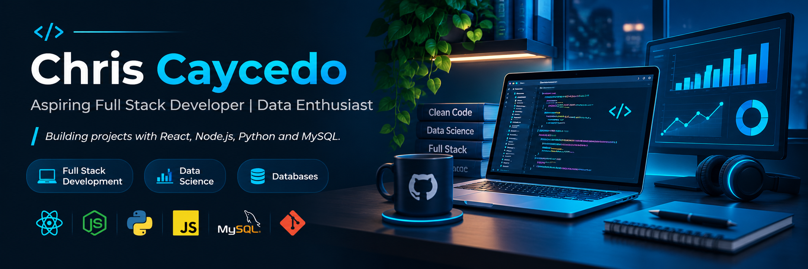

---

## 👨‍💻 About Me

I'm a Full Stack Software Developer based in Colombia, passionate about building modern web applications and exploring the world of Data Science.

- 🔭 **Currently working on:** Full-stack applications and personal projects.
- 🌱 **Currently learning:** React, Node.js, Express, Python and SQL.
- 🎯 **My goal:** Combine software engineering and data science to create useful, scalable solutions.
- 🌍 **Languages:** Spanish, English, French and learning German.

---

## 🛠️ Tech Stack

### Frontend Development

### Backend Development

### Data Science & Tools
 
